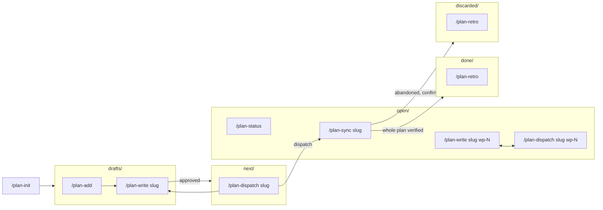

# Plan Skills Workflow

Welcome! These feature-planning skills turn a request into a clear plan, hand approved work to a coding agent, and track it until it is done. Each plan is a Markdown bundle under your `PLAN_ROOT` that moves through lifecycle folders as work progresses.

## Getting Started

1. Choose `PLAN_ROOT`, an absolute folder where plans will live. Export it or include it in your request:

   ```bash
   export PLAN_ROOT=path/to/plans
   ```

   Agents ask for this path rather than guessing it.

2. Open your harness (`copilot`, `claude`, or `pi`) before running any `/plan-*` command.

3. Initialize the folder once:

   ```text
   /plan-init path/to/plans
   ```

   This creates `README.md` and the `drafts`, `next`, `open`, `done`, and `discarded` folders.

4. Add your first plan with an ID and name:

   ```text
   /plan-add <plan-id> <plan-name>
   ```

5. Write your request for the plan:

   ```text
   /plan-write <plan-id> <written_request>
   ```

From here on, the agent will tell you which command to use to continue the workflow. The diagram below shows the full workflow.

## Plan Bundle Structure

Each plan is a bundle. The plan file is the only lifecycle owner; supporting documents are not separate plans.

```text
<PLAN_ROOT>/<lifecycle>/<plan-slug>/
├── <plan-slug>.md
├── context/
│   └── request.md
└── work-packages/
```

New bundles do not create a separate `workflows/` directory or `Workflows` subsection. The plan file includes Related documents subsections for Context and Work packages. The original request is preserved in `context/request.md`, and the `work-packages/` directory starts empty. Keep implementation phases and process details in the canonical plan or its requested work packages rather than in separate workflow documents. Work packages are created only after the user explicitly requests them.

Existing bundles may contain a legacy `workflows/` directory or `Workflows` subsection. Preserve those artifacts during ordinary commands; do not create, rewrite, or delete them unless the user explicitly requests it.

## Lifecycle States And Commands



Each folder under `PLAN_ROOT` is one lifecycle state. Only the command in the last column moves a plan out of its current folder; WP preparation, dispatch, and synchronization may update an open plan in place without moving it.

| Folder | Meaning | Reached by | Run next | Leaves through |
|---|---|---|---|---|
| `drafts/` | Request captured; investigation or approval pending | `/plan-add` | `/plan-write <slug>` | `/plan-write` after approval → `next/` |
| `next/` | Whole plan or approved first WP ready for dispatch | `/plan-write` (approval) | `/plan-dispatch <slug>` for whole-plan mode; `/plan-dispatch <slug> wp-N` for a bounded WP | `/plan-dispatch` → `open/` |
| `open/` | Work dispatched; remaining WPs or acceptance evidence pending | `/plan-dispatch` | `/plan-status` to check; `/plan-sync <slug>` to verify evidence; `/plan-write <slug> wp-N` then `/plan-dispatch <slug> wp-N` for a subsequent WP | `/plan-sync` → `done/` only when the whole plan is verified, or → `discarded/` when abandonment is confirmed |
| `done/` | Acceptance criteria and completion evidence verified | `/plan-sync` | `/plan-retro` | Terminal |
| `discarded/` | Intentionally stopped, with a reason and replacement when one exists | `/plan-sync` after confirmation | `/plan-retro` | Terminal |

`Blocked` is an index category, not a folder. A blocked plan stays in its folder and records `blocked_by` in the plan file.

Commands that do not change state:

- `/plan-init` creates the root and lifecycle folders once. Run it before any other command.
- `/plan-status` is read-only. Run it at any point to see which folder each plan is in and what it waits on.
- `/plan-retro` reads `done/` and `discarded/` and proposes skill edits. It moves nothing.
- `/plan-write <slug> wp-N` and `/plan-dispatch <slug> wp-N` can prepare/execute another WP in `open/`; neither moves an open bundle backward.

## Examples

Stage-by-stage prompt examples are in [EXAMPLES.md](EXAMPLES.md).

## Safety Rules

- The Owner is the default plan owner and final reviewer; the Prompter supplies decisions that evidence cannot resolve.
- At every lifecycle stage, require a valid absolute `PLAN_ROOT`; if it is missing, ask the user and stop without touching plan data. Never infer a fallback path.
- Never invent an issue number. Use `XXXX` when it is missing.
- Never store credentials, tokens, or secret-bearing conversation text in a plan.
- Do not rename or rewrite legacy plans during initialization.
- Do not treat context or work-package files as separate lifecycle plans.
- Do not create plan-bundle `workflows/` directories or separate workflow documents.
- Do not create work packages without an explicit user request.
- Require explicit WP selection and recorded scope approval for bounded dispatch; never widen it, auto-run prerequisites, or start the next WP automatically.
- Keep shared blockers at plan level; do not hide them as deferred-WP gates.
- Keep the complete bundle open until every required WP and the combined completion criteria are verified.
- Do not merge reviews, transition external work items, trigger releases, or deploy merely to make a plan appear complete.
