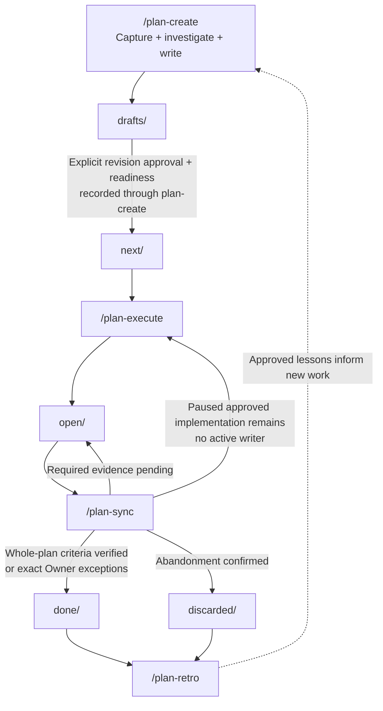

# Feature-planning v2

Four commands turn a request into an approved implementation contract, execute it, reconcile evidence, and learn from the outcome. One `plan.md` has a human TL;DR and a complete, context-efficient agent view; `artifacts/` holds supporting evidence.

## Quick Start

1. Supply an **absolute** planning root in your request or visible environment. The agent asks rather than guessing:

   ```bash
   export PLAN_ROOT="/absolute/path/to/PLANNING"
   ```

2. Capture and investigate a request. First use initializes only the explicitly selected root:

   ```text
   /plan-create Validate configuration before saving; preserve existing errors and add regression tests.
   ```

3. Review the generated plan. Explicitly approve its identified scope revision, recording that approval through the same command:

   ```text
   /plan-create plan-XXXX-config-validation
   Approve scope revision 1 as written. Record this approval; do not implement yet.
   ```

   Approval alone does not cure missing readiness/dependencies. The bundle moves from drafts to next only when both approval and readiness pass.

4. Execute that approved plan:

   ```text
   /plan-execute plan-XXXX-config-validation
   ```

5. Reconcile actual delivery and acceptance evidence; incomplete work stays open:

   ```text
   /plan-sync plan-XXXX-config-validation
   ```

6. Review the completed/discarded outcome and propose improvements:

   ```text
   /plan-retro plan-XXXX-config-validation
   ```

Every result ends with **`Next: /plan-<command> <actual-slug> — <gate if any>`**, including blocked/failed/unchanged results. Recommendations never auto-run work or bypass approval. If no target/new task exists, necessary placeholders are explicitly labeled.

## Lifecycle



`drafts/` maps to metadata `status: "draft"`; other folder/status names match. An open plan resumes or is revised in place, never silently moves backward. Done/discarded plans are not redispatched. Blocked is a named wait, not another folder.

## Storage And Two Views

```text
<PLAN_ROOT>/
├── README.md
├── drafts/
├── next/
├── open/
├── done/
│   └── plan-1234-example/
│       ├── plan.md
│       └── artifacts/
│           ├── request.md
│           └── verification.md      # optional sanitized evidence
└── discarded/
```

- **`tldr-version`:** only Scope, Status, Delivered, Next and optional Diagram, in that order. Maximum 299 words excluding diagrams. Every delivered statement links its supporting commits when available; otherwise say `commit unavailable`/`uncommitted`. No delivery yet: `None yet.`
- **`agent-version`:** one current resume/checkpoint, approved scope revision, exact implementation steps/files/symbols, verification/negative cases, relevant decisions/dependencies, evidence/outcome and append-only history. No length cap, duplicated receipts or extension requirement.
- **`artifacts/`:** original sanitized requests/approvals plus useful evidence. Not independent plans or shadow task/workflow documents. No work-package/workflow folders or separate audience files.

Update both views after mutations; read-only inspection changes neither. Full-scope approval and acceptance are separate. Owner-reported tests, absent CI, local closure and external operational/tracker/deployment acceptance remain distinguishable; a merge or green local check alone is not done.

## Examples, Upgrades, And Validation

- [Examples](EXAMPLES.md): four-stage prompts and a complete illustrative draft.
- [Migration](MIGRATION.md): retired commands, explicit legacy conversion, stale-install warnings.
- [Behavioral acceptance checklist](ACCEPTANCE.md): safety scenarios that structural tests cannot prove.

## Advanced Reference

The internal [shared contract](plan-spec/SKILL.md) is read by each stage; it is not a user workflow step. The optional [read-only status skill](plan-status/SKILL.md) inspects local recorded status (`full` requests available read-only remote evidence) and always recommends a next primary command. It never repairs data or starts work.

Pi installations include prompt aliases for the documented `/plan-*` spellings; the native `/skill:plan-create` form also works. Reload after installation and grant normal project trust before using project resources. Aliases only load the skill and pass arguments, adding no implementation authority or runtime extension.

The [plan template](plan-spec/templates/plan.md) and standard-library [validator](plan-spec/scripts/validate_plan.py) ship beside the contract. Resolve their paths from this document, not the working directory. The validator checks format, declared readiness, index and local links; it does not prove consent, truthful receipts, remote commit existence, real tests/CI, or agent behavior.
