# Plan Skills Workflow

The plan skills manage implementation work under `PLAN_ROOT`. The lifecycle folders are:

## Required PLAN_ROOT Gate (Every Stage)

Before any planning-lifecycle stage—including init, add, write, dispatch, status, sync, retro, or creating supporting workflows/work packages—resolve a non-empty absolute `PLAN_ROOT` from the current request/conversation, explicit repository/workspace configuration, or an environment value visible to the agent. Do not rely on a value remembered from another conversation or another machine.

If no valid path is available, stop before searching, reading, or changing plan data and ask: `What absolute path should I use for PLAN_ROOT?` Wait for the user's answer. Never guess a folder, use the repository root as a fallback, or create a candidate location. If a configured path is invalid or inaccessible, ask for a correction rather than falling back. Only `/plan-init` may create the specified root, and only after the gate passes; every other stage requires the specified root to exist. If it or expected lifecycle folders are missing, stop and direct the user to `/plan-init` rather than initializing implicitly.

The canonical policy is in `plan-spec/SKILL.md` and applies even when a stage is invoked through a prompt example below.

- `drafts/`: captured requests and canonical plans that still need investigation or approval.
- `next/`: approved plan bundles with a whole-plan or explicitly bounded first-WP scope ready for dispatch.
- `open/`: dispatched or implemented plans with remaining WPs or review, CI, release, deployment, or other dependencies.
- `done/`: plans whose acceptance criteria and completion evidence are verified.
- `discarded/`: plans intentionally stopped with a reason and, when available, a replacement link.

`Blocked` is an index category, not a folder. A blocked plan stays in the lifecycle folder that matches its current status and records `blocked_by` in the canonical file.

## Plan Bundle Structure

Each plan is a bundle. The canonical file is the only lifecycle owner; supporting documents are not separate plans.

```text
<PLAN_ROOT>/<lifecycle>/<plan-slug>/
├── <plan-slug>.md
├── context/
│   └── request.md
├── workflows/
└── work-packages/
```

`workflows/` and `work-packages/` remain empty during the initial draft pass. The canonical file is created first and includes empty Related documents subsections for Context, Work packages, and Workflows.

The original request is preserved in `context/request.md`. Workflow documents are created only after the user approves the canonical plan. Work packages are created only after the user explicitly requests them.

## Filename Rule

Every new plan uses the same slug for its bundle directory and canonical file:

```text
<plan-slug>/<plan-slug>.md
```

For plans with an issue number:

```text
<PREFIX>-<NUMBER>-<NAME>/<PREFIX>-<NUMBER>-<NAME>.md
```

For plans without an issue number:

```text
<PREFIX>-XXXX-<inferred-name>/<PREFIX>-XXXX-<inferred-name>.md
```

`<PREFIX>` is the plan prefix configured for the plan root (`Plan prefix:` in `<PLAN_ROOT>/README.md`) or named in the request; when nothing defines one, use `plan`. For example, `Plan prefix: iiot` yields `iiot-1212-balbla/iiot-1212-balbla.md`. `<NAME>` is a lowercase, hyphen-separated slug inferred from the request, with no more than four words. Work packages use `wp-<N>-<short-description>.md`. Existing bundles keep their prefix; legacy files are indexed or archived but are not renamed automatically.

## Workflow

```mermaid
flowchart LR
    init["/plan-init"] --> root["Configured PLAN_ROOT\nREADME + lifecycle folders"]
    root --> add["/plan-add"]
    add --> context["context/request.md"]
    context --> draft["Canonical plan\nStatus/Summary/Diagram/Steps/Verification/Estimations"]
    draft --> approval{"User approves\ncanonical plan?"}
    approval -->|"no"| draft
    approval -->|"yes"| workflows["workflows/\ncreated when requested"]
    approval -->|"yes + explicit request"| packages["work-packages/\ncreated on request"]
    draft -->|"ready"| next["next/<plan-slug>/"]
    next --> dispatch["/plan-dispatch"]
    dispatch --> open["open/<plan-slug>/"]
    open --> status["/plan-status\nread-only"]
    open --> sync["/plan-sync"]
    open -->|"prepare another WP"| prepare["/plan-write <slug> wp-N\nbundle stays open"]
    prepare -->|"WP approved + ready"| dispatch
    sync -->|"WP verified; scope remains"| open
    sync -->|"whole plan verified"| done["done/<plan-slug>/"]
    sync -->|"abandoned with confirmation"| discarded["discarded/<plan-slug>/"]
    done --> retro["/plan-retro"]
    discarded --> retro
    retro -->|"approved workflow improvement"| skills["plan skills"]
```



`/plan-spec` is the shared contract read by every lifecycle skill. `task-planning` supplies the detailed canonical-plan format used during investigation.

## Lifecycle States And Commands

Each folder under `PLAN_ROOT` is one lifecycle state. Only the command in the last column moves a plan out of its current folder; WP preparation, dispatch, and synchronization may update an open plan in place without moving it.

| Folder | Meaning | Reached by | Run next | Leaves through |
|---|---|---|---|---|
| `drafts/` | Request captured; investigation or approval pending | `/plan-add` | `/plan-write <slug>` | `/plan-write` after approval → `next/` |
| `next/` | Whole plan or approved first WP ready for dispatch | `/plan-write` (approval) | `/plan-dispatch <slug>` for whole-plan mode; `/plan-dispatch <slug> wp-N` for a bounded WP | `/plan-dispatch` → `open/` |
| `open/` | Work dispatched; remaining WPs or acceptance evidence pending | `/plan-dispatch` | `/plan-status` to check; `/plan-sync <slug>` to verify evidence; `/plan-write <slug> wp-N` then `/plan-dispatch <slug> wp-N` for a subsequent WP | `/plan-sync` → `done/` only when the whole plan is verified, or → `discarded/` when abandonment is confirmed |
| `done/` | Acceptance criteria and completion evidence verified | `/plan-sync` | `/plan-retro` | Terminal |
| `discarded/` | Intentionally stopped, with a reason and replacement when one exists | `/plan-sync` after confirmation | `/plan-retro` | Terminal |

Commands that do not change state:

- `/plan-init` creates the root and lifecycle folders once. Run it before any other command.
- `/plan-status` is read-only. Run it at any point to see which folder each plan is in and what it waits on.
- `/plan-retro` reads `done/` and `discarded/` and proposes skill edits. It moves nothing.
- `/plan-write <slug> wp-N` and `/plan-dispatch <slug> wp-N` can prepare/execute another WP in `open/`; neither moves an open bundle backward.

## Work-Package-By-Work-Package Execution

Keep one canonical plan and one lifecycle/index entry for the feature. Use a positional `wp-N` selector to prepare or dispatch exactly one WP already defined in the canonical Steps or linked supporting document. Do not create a separate `<ticket>-wp1` plan or move a supporting WP file between lifecycle folders.

`plan-spec` defines the canonical `## Execution scope` table and WP progress states: `planned`, `ready`, `in-progress`, `in-review`, `verified`, and `blocked`. Record approval coverage, dependencies, the bounded implementation scope, branch/base, exact checks, and evidence there or in the canonical Verification/Dispatch Log. Later WPs stay visible but are not authorized by the current dispatch. Empty supporting folders are still valid for whole-plan execution; a WP selector does not implicitly create a file.

The first approved slice moves the entire bundle `drafts → next → open`. Subsequent slices stay in `open`: prepare/approve the next WP, dispatch it explicitly, verify its evidence, and repeat. Dependencies require verified predecessor evidence unless explicitly approved as parallel-safe with isolated ownership. Do not automatically start another WP after a handoff, or widen a WP-mode plan to whole-plan dispatch when its selector is omitted.

`/plan-sync` may verify a WP while keeping the parent open. A completed WP, or its merged PR alone, does not complete the feature; every required WP and the combined plan-level criteria must pass before `done`.

## Prompts By Stage

### 1. Initialize the lifecycle

```text
/plan-init

First resolve and validate an absolute PLAN_ROOT from the current request, explicit repository/workspace configuration, or an environment value visible to the agent. If none is available, ask the user for the path and stop without inspecting or creating anything. Once the gate passes, create or verify README.md and the drafts, next, open, done, and discarded folders. Preserve legacy content, do not rename legacy files, do not modify product code, and do not commit. Report every created or existing path.
```

### 2. Capture a request as a draft

With an issue number:

```text
/plan-add

Capture this request as a plan bundle:
- Issue number: 2851
- Request: expose application instances through the extension routes
- Constraints: preserve existing route behavior and add focused verification

Create plan-2851-<inferred-name>/ under $PLAN_ROOT/drafts/, preserve the request in context/request.md, and create the canonical Markdown skeleton. Leave workflows/ and work-packages/ empty. Do not implement product code.
```

Without an issue number:

```text
/plan-add

Capture this request as a plan bundle:
- Request: validate dynamic request bodies before forwarding them
- Constraints: preserve current error responses where compatible

No issue number was provided. Use plan-XXXX-<inferred-name>/, infer a lowercase name of at most four words, and do not guess a number. Preserve the request in context/request.md, create the canonical Markdown skeleton, leave workflows/ and work-packages/ empty, and do not implement product code.
```

### 3. Investigate and write the canonical plan

```text
/plan-write plan-XXXX-dynamic-body-validation

First append this input and its references to the plan bundle's context/request.md. Read the bundle and its sources. Inspect the smallest controlling code path, neighboring tests, configuration, history, and affected repository boundaries. Write or update only the canonical Markdown file using Status, Summary, Diagram, Steps, Verification, Estimations, and Related documents with empty Context, Work packages, and Workflows subsections. Do not create workflows or work packages. Keep the bundle in drafts until the canonical plan is approved.
```

### 4. Create workflows after approval

```text
Create the workflow documents for the approved canonical plan plan-XXXX-dynamic-body-validation. Store them under its workflows/ directory, tag them with the canonical issue ID, link them from Related documents, and do not create work packages unless separately requested.
```

### 5. Create work packages on request

```text
Create work packages for the approved canonical plan plan-XXXX-dynamic-body-validation. Split the approved phases into wp-1-<short-description>.md files under work-packages/, begin each with the issue tag, title, and ## Goal, link them from Related documents, and do not add automatic Plan mapping or Source reference blocks.
```

### 6. Dispatch an approved plan

```text
/plan-dispatch plan-XXXX-dynamic-body-validation

Dispatch the whole canonical plan bundle from $PLAN_ROOT/next/ to an isolated coding agent, only if no WP boundary is recorded. Preserve unrelated worktree changes, run the exact verification commands before and after repairs, record the branch, commits, review URL, checks, deviations, and blockers, and never merge the review.
```

To prepare only the first defined WP:

```text
/plan-write plan-XXXX-dynamic-body-validation wp-1

Prepare WP-1 as the first bounded slice in the canonical plan. Record the overall scope/architecture approval and WP-1 approval separately, retain all later WPs, and name exact files, branch/base, dependencies, acceptance criteria, and checks. Do not create supporting files or implement anything. Move the bundle to next only when the selected scope is approved and ready.
```

Then dispatch that scope explicitly:

```text
/plan-dispatch plan-XXXX-dynamic-body-validation wp-1

Implement WP-1 only. Other WPs are context, not implementation authority. Stop after its checks and draft-review handoff. Do not start WP-2 or mark the parent plan done.
```

After `/plan-sync plan-XXXX-dynamic-body-validation` verifies WP-1, prepare and explicitly dispatch WP-2 using the same commands with `wp-2`. The existing canonical bundle stays in `open/`; resolve dependency and approval gates before proceeding. WP preparation does not authorize execution.

### 7. Report status

```text
/plan-status

Report all canonical plan bundles under $PLAN_ROOT. Validate folder status against canonical frontmatter first, then report execution mode, per-WP readiness/progress where recorded, dependencies, review state, CI or release evidence, and person, decision, system, or implementation blockers. Do not report supporting files as separate plans. This is read-only.
```

```text
/plan-status iiot-2789

Quick status for one plan: its folder, the commands already run from its History, flags, and one next command. Read local files only; add `full` to include review and CI state.
```

### 8. Synchronize completed work

```text
/plan-sync plan-XXXX-dynamic-body-validation

Compare the canonical plan and its work packages with implementation, review, CI, external work item, release, and deployment evidence. Update per-WP verification in the canonical Execution scope when present. Keep the complete bundle open while any required WP or plan-level evidence remains; do not infer whole-plan completion from the last dispatched slice. Move it to done only when the completion rule passes, or to discarded only after the Owner or Prompter confirms abandonment. Update the canonical outcome without merging, committing, or automatically dispatching another WP.
```

### 9. Learn from completed work

```text
/plan-retro

Review recently done and discarded canonical plan bundles, work-package corrections, implementation-agent changes, review feedback, CI failures, commits, and available session history. Identify repeated workflow problems using at least two examples, propose the smallest exact skill edits, and wait for approval before changing any skill. Do not commit.
```

## Safety Rules

- The Owner is the default plan owner and final reviewer; the Prompter supplies decisions that evidence cannot resolve.
- At every lifecycle stage, require a valid absolute `PLAN_ROOT`; if it is missing, ask the user and stop without touching plan data. Never infer a fallback path.
- Never invent an issue number. Use `XXXX` when it is missing.
- Never store credentials, tokens, or secret-bearing conversation text in a plan.
- Do not rename or rewrite legacy plans during initialization.
- Do not treat context, workflow, or work-package files as separate lifecycle plans.
- Do not create workflows before canonical-plan approval.
- Do not create work packages without an explicit user request.
- Require explicit WP selection and recorded scope approval for bounded dispatch; never widen it, auto-run prerequisites, or start the next WP automatically.
- Keep shared blockers at plan level; do not hide them as deferred-WP gates.
- Keep the complete bundle open until every required WP and the combined completion criteria are verified.
- Do not merge reviews, transition external work items, trigger releases, or deploy merely to make a plan appear complete.
