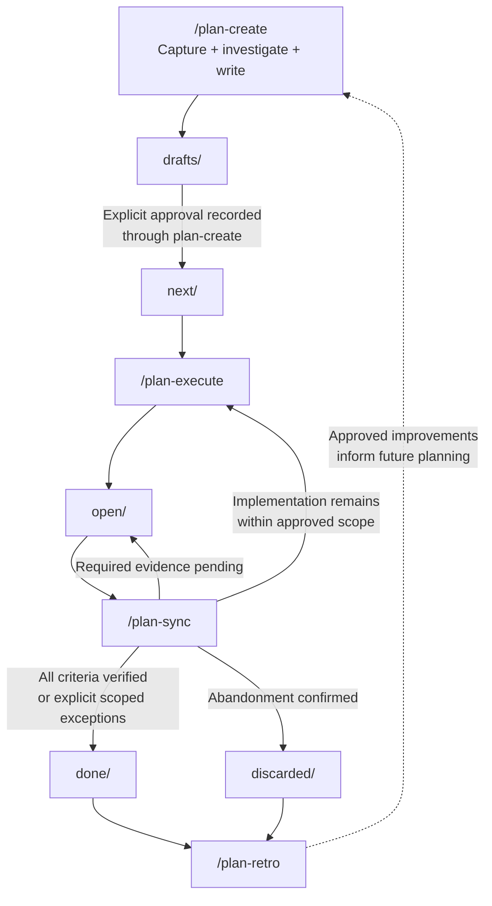
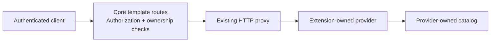

# Feature-planning v2 — Implementation Prompt and Examples

## Design decisions

Upgrade the existing collection in place rather than creating a second planning system.

- **Four primary commands:** `plan-create`, `plan-execute`, `plan-sync`, `plan-retro`.
- **One `plan.md`, two views:** `tldr-version` first, then `agent-version`.
- **One supporting folder:** `artifacts/`.
- **Fixed TL;DR fields:** Scope, Status, Delivered, Next, and an optional Diagram. Link every delivered claim to its supporting commits when available.
- **Always recommend the next command:** every planning-stage result ends with an explicit command and any readiness condition.
- Preserve the approval, evidence, security, and local-versus-external completion safeguards learned from IIOT-2789, IIOT-2913, and IIOT-2916.

“Two versions” means **two sections of the same file**, not two separately maintained documents. Use `/plan-execute` as the canonical name throughout this proposal.

This document is a future implementation handoff. Preparing it does not implement the skills or migrate the vault. Example commands and completed plans below are illustrative, not instructions to redispatch completed work.

## Prompt for the implementation agent

Implement **feature-planning v2** in the existing KILab coding-agent pack.

This is an upgrade of the existing collection, not a new parallel package. Keep the installation selector `feature-planning`.

### Working scope

Repository:

```text
/Users/franciscosusana/workspace/KILab
```

Primary collection:

```text
coding-agent-pack/catalog/core/skills/feature-planning
```

Read-only source material:

```text
/Users/franciscosusana/workspace/vault/PLANNING
```

Inspect:

- The current feature-planning skills, `README.md`, and `EXAMPLES.md`.
- The vault index and representative draft/completed plans.
- IIOT-2789, IIOT-2916, and especially IIOT-2913's retrospective.
- The pack README, installer, validator, tests, and relevant adapters.

Preserve existing uncommitted changes. In particular, do not lose the recent credential-output, lifecycle-link, and completion-evidence safeguards.

Implement only the skill collection, its documentation, focused tests, and the minimal installer/validation changes necessary to support it.

**Do not** modify or migrate the actual vault, implement any product feature described by its plans, install into real user/global configurations, commit, push, publish, or deploy.

### Goal

Reduce command count, duplicated documentation, and agent context cost without weakening implementation clarity, approval boundaries, evidence, resumability, or safety.

### 1. Primary commands

The normal workflow has exactly four primary commands:

- `/plan-create`
- `/plan-execute`
- `/plan-sync`
- `/plan-retro`

Use `plan-execute` consistently as the canonical name. Do not introduce a second implementation for `plan-exec`.

Retain:

- `plan-spec`: the internal shared contract.
- `plan-status`: an optional, read-only supporting command.

Do not show `plan-spec` or `plan-status` in the main lifecycle diagrams or quick start. Mention them only where necessary, such as internal skill instructions, reference documentation, or troubleshooting. They must not be mandatory steps in the normal workflow.

Consolidate the useful behavior of `plan-init`, `plan-add`, `plan-write`, and `task-planning` into `plan-create` and the shared specification. Replace `plan-dispatch` with `plan-execute`.

Remove the superseded commands from the active collection after absorbing their necessary behavior. Document old-to-new command mapping in migration notes rather than retaining a second workflow.

### 2. Plan storage

Retain these lifecycle folders under an explicitly configured `PLAN_ROOT`:

```text
README.md
drafts/
next/
open/
done/
discarded/
```

Every newly generated v2 plan has exactly this top-level bundle structure:

```text
<lifecycle>/<plan-slug>/
├── plan.md
└── artifacts/
    ├── request.md
    └── <optional supporting material>
```

Rules:

- The canonical filename is always `plan.md`, not `<plan-slug>.md`.
- Rename the concept `context` to `artifacts`.
- Preserve the sanitized original request and subsequent request/approval additions in `artifacts/request.md`.
- Create other artifacts only when useful: screenshots, research evidence, contract references, sanitized verification receipts, or detailed logs.
- Artifacts are supporting evidence, never independent plans.
- No `work-packages/` or `workflows/` directories.
- No WP files, WP selectors, WP execution tables, or separate workflow documents.
- Do not recreate work packages under another name inside `artifacts/`.
- Implementation steps belong directly in `plan.md`.
- Move the complete bundle between lifecycle folders.

Keep naming configurable and preserve exact external identifiers. Never invent an issue number; use `XXXX` where a number is required but unknown. Detect ambiguous matches and duplicates instead of guessing.

Add a clear planning-schema version marker, such as `schema_version: 2`. Do not confuse this with the pack's existing release version.

Keep lifecycle metadata explicit and consistent. Document the mapping between status `draft` and folder `drafts/`; other lifecycle names match their folders.

The root README is a compact index, not another copy of each plan.

### 3. Two views in one file

Use these stable section boundaries:

```markdown
---
# Shared YAML frontmatter, including schema_version: 2
---
# <identifier and title>

## tldr-version

**Scope:** <Concise implementation boundary>

**Status:** <Current state; essential blockers or acceptance limits>

**Delivered:**
- <Delivered claim with supporting commit links when available, or "None yet.">

**Next:** `/plan-<command> <resolved-plan-slug-or-request>` — <readiness condition, if any>

**Diagram:** <Optional Mermaid block; omit this field when no useful diagram is possible>

## agent-version

<Implementation contract and durable handoff>
```

There must not be separate `agent.md`, `tldr.md`, or audience-specific folders.

#### tldr-version

This human-readable synthesis contains **only these fields, in this order**:

1. **Scope:** a concise description of what the plan implements and its essential boundary.
2. **Status:** current lifecycle/progress, essential blockers, and any qualification necessary to avoid overstating completion. Keep detailed verification evidence and exceptions in `agent-version`; summarize critical limits here when needed for accuracy.
3. **Delivered:** one bullet per delivered statement. Include a direct Markdown link to the supporting commit(s) in **every bullet when those commits are available**. Use the exact repository and commit IDs from authoritative evidence. A PR link may supplement, but must not replace, a known commit link. For multi-repository delivery, link each claim to its own supporting repository/commits. Never invent a commit or URL; mark genuinely unavailable evidence as `commit unavailable` or a verified uncommitted change as `uncommitted`. If nothing is delivered, write `None yet.` Do not present planned work as delivered or equate implementation with full acceptance.
4. **Next:** the exact next recommended planning command with its resolved plan slug/request and any prerequisite or approval gate. Follow the mandatory next-command rule below; a vague action such as “continue” or “await approval” is not enough.
5. **Diagram:** a concise Mermaid diagram when possible and useful. Show only relationships supported by the plan/evidence; do not invent architecture to fill this field. Omit the field when a useful diagram is not possible.

Do not add separate Summary, Evidence, Limits, Implementation steps, Estimates, or other fields to this view. Put that detail in `agent-version` or `artifacts/`.

It must contain **fewer than 300 words: maximum 299**. Exclude only diagram blocks from the count; count all other content in this section, including field labels and link text. Define a deterministic counting rule and validate examples against it.

Keep it current after every command that changes the plan. It is a derived view, not a separately approved or competing specification.

#### agent-version

This is the implementation contract, together with shared metadata. It has no arbitrary word limit, but must be information-dense.

Use Caveman-inspired economy:

- Short technical statements.
- Exact paths, symbols, identifiers, commands, and constraints.
- Tables/checklists where they reduce repetition.
- References instead of repeatedly copying evidence.
- No conversational filler, repeated summaries, or ceremonial empty sections.

Do not sacrifice security, negative cases, compatibility, approval boundaries, or verification precision to save tokens. Do not require a Caveman extension or any other runtime extension.

Start with a compact resume block:

- Current state and completed/remaining work.
- Current blocker or checkpoint.
- Exact next recommended command, its readiness gate, and any required approval.
- References needed to continue.

Then include the relevant implementation contract:

- Goal, scope, non-goals, and compatibility.
- Current behavior and evidence: `landed`, `partially landed`, `planned`, `blocked`.
- Decisions, assumptions, dependencies, and named owners.
- Explicit approval and the implementation-scope revision it covers.
- Affected repositories, files, symbols, and branch/base when applicable.
- Dependency-ordered implementation steps with acceptance criteria.
- Exact verification commands, working directories, prerequisites, expected results, and important negative cases.
- Execution/checkpoint receipts and links to detailed artifacts.
- Outcome, explicit exceptions, and outstanding external acceptance.
- Compact append-only history.

Keep the current snapshot current. Do not accumulate multiple contradictory paragraphs labeled “current”.

Keep detailed logs in artifacts when that reduces repeated loading, but retain actionable scope, stop conditions, and acceptance criteria in `plan.md`.

A scope change requires explicit reapproval of the changed contract. An evidence/status-only refresh must not invalidate otherwise unchanged scope approval.

Update both views consistently in each mutation. Read-only commands must not rewrite either view.

### 4. Command behavior

#### /plan-create

- Resolve and validate the explicit absolute `PLAN_ROOT`.
- If missing or invalid, ask for it and stop before scanning plan data.
- On first use, initialize only that explicitly selected root, index, and lifecycle folders, idempotently and without overwriting existing work.
- Capture the request, investigate real code/tests/configuration/history, and create or update the two-view plan.
- Do not implement the planned product change.
- Keep unapproved or materially unresolved work in `drafts/`.
- Record explicit approval of an identified implementation-scope revision.
- Move an approved, implementation-ready draft to `next/`.
- Allow revision/resumption of an existing plan without creating duplicates.
- Do not silently move an open plan backward or erase execution evidence.

#### /plan-execute

- Implement exactly one explicitly selected, approved v2 plan.
- Require readiness, current approval, dependency checks, and safe worktree ownership before implementation.
- Move `next/` to `open/` when execution actually begins.
- Resume an open plan from recorded checkpoints; do not replay completed work or start duplicate writers.
- Work through the approved inline implementation steps.
- Stop and ask when a necessary change exceeds the approved boundary.
- Record exact checks, results, deviations, branch/commit/review information when applicable, and remaining work.
- Honor recorded publication permissions and repository policy.
- Never infer permission to merge, transition external work items, release, or deploy.
- Leave completion verification to `plan-sync`.
- Do not make subagent orchestration mandatory. Use delegation only when authorized and supported by the current harness.

#### /plan-sync

- Reconcile the approved plan with actual implementation, checks, reviews, and any required external evidence.
- Refresh both views and the compact index.
- Keep work open while required acceptance evidence remains unresolved.
- Move to `done/` only when all required criteria are verified or an Owner explicitly accepts precisely recorded exceptions.
- Never convert a general “tested/approved” statement into independently rerun tests, live-cloud acceptance, role enablement, or deployment proof.
- Move to `discarded/` only after explicit abandonment confirmation.
- Do not implement missing features or mutate remote systems to manufacture completion.
- Repair affected live links during lifecycle moves and validate them. Preserve historical quoted paths and previous evidence.

#### /plan-retro

- Review completed/discarded plans, execution evidence, corrections, review feedback, and failures.
- Record plan-specific findings under `agent-version` without creating a separate workflow document.
- Propose small, evidence-backed improvements to the skills.
- Require repeated evidence for durable rules, except a severe security or data-loss incident may justify immediate attention.
- Do not apply skill changes without explicit approval.
- Do not reopen or redispatch completed work.

#### Mandatory next-command recommendation

Every user-facing planning-skill result must end with **one explicit `Next:` line** recommending the next primary command. This applies to all four primary commands and optional `plan-status` results, including blocked, failed, unchanged, checkpoint, and handoff responses. Never omit the recommendation or replace the command with only a question, approval request, or prose action.

Format:

```text
Next: /plan-<command> <resolved-plan-slug-or-request> — <brief reason or readiness condition>
```

Use the actual resolved slug/request whenever available, not a generic placeholder. When a required path, target, or request is unknown, ask for it and clearly label any necessary placeholder; do not invent arguments or imply the command is ready to run.

Choose from the actual state:

| State | Recommended next command |
| --- | --- |
| Draft needs investigation, revision, or approval recording | `/plan-create <slug>` with the unresolved gate named |
| Approved and ready in `next/` | `/plan-execute <slug>` |
| Open; paused approved work remains and no writer is active | `/plan-execute <slug>` after resume/readiness gates pass |
| Open; implementation is running or review/check evidence is pending | `/plan-sync <slug>` once the named evidence is available; never recommend a duplicate execution |
| Open; changed scope needs revision/reapproval | `/plan-create <slug>`; keep the bundle open |
| Done or discarded | `/plan-retro <slug>` |
| Retro proposes changes awaiting approval | `/plan-retro <selection>` after explicit approval to apply the accepted edits |
| Retro complete; no follow-up remains | Conditionally recommend `/plan-create <new-request>` when the user has another task; explicitly label the new-request placeholder |

For mutating commands, keep the TL;DR `Next` field, agent resume block, and final response recommendation aligned. Read-only results recommend the next command without editing the plan. A recommendation is never permission to auto-run a command, bypass approval, restart completed work, or select another plan.

### 5. Safeguards to preserve

- Explicit absolute `PLAN_ROOT`; no guessed vault or repository fallback.
- Original request, approvals, history, and factual evidence preserved.
- No secret-bearing conversation dumps, credentials, or raw credential-bearing remote URLs in plans or output.
- Prefer remote names rather than raw `git remote -v`.
- Exact command/result provenance and tested commit/base when applicable.
- Owner-reported tests distinguished from independently executed checks.
- Missing or inaccessible evidence marked `unverified`, not passed.
- A merged review or successful agent run is not automatically acceptance.
- Local plan closure is distinct from issue-tracker, operational, release, deployment, and downstream acceptance.
- Exceptions are explicit, scoped, and never inherited automatically.
- Preserve unrelated edits and other active writers.
- Re-read before writing when concurrent changes may have occurred.
- Do not weaken acceptance criteria merely to close a plan.

### 6. Legacy content

The existing vault is evidence and remains untouched by this implementation.

Recognize/index legacy plans read-only where necessary. Require explicit migration authorization before converting one.

Document a migration approach that preserves requests, approvals, implementation contracts, receipts, history, and live links while consolidating executable scope into `plan.md`.

Do not bulk-rename, delete, or silently convert old bundles. Do not retain a second WP-based execution model inside the v2 core.

### 7. Pack integration and validation

Keep generic core content harness-neutral and free of user-specific paths or project-specific assumptions copied from the vault.

Preserve the nested skill collection layout. Do not add a root `SKILL.md` that causes the installer to skip the individual stage skills.

Verify installation for Copilot, Claude, and Pi using temporary targets. Their rendering/layout behavior differs; do not assume source-relative links or frontmatter survive unchanged.

Ensure:

- All four primary skills and the two supporting skills remain discoverable or internally accessible as appropriate for each harness.
- Internal `plan-spec` references resolve after installation.
- Installed README/example links resolve.
- Existing unrelated user files are preserved.
- Stale installed v1 commands are reported with explicit upgrade guidance, not removed by broad or unapproved directory cleanup.

Add focused automated checks where practical and a clearly separated behavioral acceptance checklist.

Cover:

- Required skill names/frontmatter and deprecated-command removal.
- Quick start/main diagrams containing only the four primary commands.
- v2 bundle structure without WP/workflow generation.
- TL;DR containing only Scope, Status, Delivered, Next, and an optional Diagram, in that order.
- Every Delivered claim linking its supporting commits when available, with honest missing/uncommitted fallbacks and no fabricated links.
- TL;DR counting: 299 words passes, 300 fails, diagrams excluded.
- Explicit next-command recommendations with resolved arguments and gates for success, blocked, failed, unchanged, checkpoint, handoff, status, and retro results; aligned with both plan views when mutated.
- Explicit-root and approval failure cases.
- Execution resume/checkpoint behavior.
- Read-only status behavior.
- Missing CI, Owner-reported tests, and scoped local-closure exceptions.
- Lifecycle/status mapping, index uniqueness, and live-link repair.
- Fresh and upgrade installation behavior across all three harnesses.

Do not claim a text-pattern check proves agent behavior.

Run:

```bash
./coding-agent-pack/scripts/validate-pack.sh
```

### Final delivery

Return:

- A concise summary of the v2 design and changed files.
- New command mapping and example usage.
- Skill and plan folder structures.
- A representative two-view plan example.
- Checks actually run and their results.
- Any remaining limitations or migration decisions.
- A final `Next:` command recommendation with concrete arguments where known and explicit prerequisites or labeled placeholders where necessary.

Do not commit, push, migrate the vault, or implement any feature described by its plans.

## Reference: proposed folder structures

### Skill collection

```text
coding-agent-pack/catalog/core/skills/feature-planning/
├── README.md
├── EXAMPLES.md
├── plan-create/
│   └── SKILL.md
├── plan-execute/
│   └── SKILL.md
├── plan-sync/
│   └── SKILL.md
├── plan-retro/
│   └── SKILL.md
├── plan-spec/                 # Internal shared contract
│   └── SKILL.md
└── plan-status/               # Optional read-only inspection
    └── SKILL.md
```

### Future PLANNING

This shows the proposed format, **not a migration already performed**.

```text
PLANNING/
├── README.md
├── drafts/
│   └── iiot-2790-network-scan/
│       ├── plan.md
│       └── artifacts/
│           ├── request.md
│           └── investigation.md          # Optional
├── next/
├── open/
├── done/
│   └── iiot-2916-modules-templates/
│       ├── plan.md
│       └── artifacts/
│           ├── request.md
│           ├── source-evidence.md        # Optional
│           └── verification.log          # Optional, sanitized
└── discarded/
```

Inside each `plan.md`:

```text
Shared YAML metadata
Title
tldr-version       ← Scope / Status / Delivered / Next / optional Diagram; maximum 299 words
agent-version      ← Implementation contract and durable handoff
```

There are **no separate audience files, work packages, or workflow documents**.

## Reference: primary lifecycle



`plan-create` absorbs first-use initialization, so there is no separate initialization command in the quick start.

## Reference: IIOT-2916 in the v2 format

The vault already records this case as completed. The following is an **illustrative v2 representation**, not a proposal to implement it again. Paths under `artifacts/` represent the proposed future arrangement; they have not been created or migrated.

Proposed location:

```text
PLANNING/done/iiot-2916-modules-templates/plan.md
```

### tldr-version

**Scope:** Implement reusable core template routes and active-route ownership protection, reusing existing proxy, schema-reference, and authorization mechanisms.

**Status:** Done locally by explicit Owner acceptance. Build/test CI was absent and explicitly excepted for this plan. At recorded closure, Jira remained To Do; production-provider, live-device, and deployment acceptance were not claimed.

**Delivered:**
- Template/query contract and nested OpenAPI references — [`8484c11`](https://github.com/eclipse-sealman/sealman-edge-config-api/commit/8484c1104dd23d9fb780bf278a7bdc654bd47544).
- Independent global actions and authorization coverage — [`8484c11`](https://github.com/eclipse-sealman/sealman-edge-config-api/commit/8484c1104dd23d9fb780bf278a7bdc654bd47544).
- Active-route conflict rejection — [`8484c11`](https://github.com/eclipse-sealman/sealman-edge-config-api/commit/8484c1104dd23d9fb780bf278a7bdc654bd47544).
- Neutral fixtures, conformance tests, and documentation — [`8484c11`](https://github.com/eclipse-sealman/sealman-edge-config-api/commit/8484c1104dd23d9fb780bf278a7bdc654bd47544).

**Next:** `/plan-retro iiot-2916-modules-templates` — review lessons; do not redispatch completed implementation.

**Diagram:**



### agent-version — representative excerpt

```markdown
### Resume
- State: done; local closure accepted.
- Implementation remaining: none within approved core scope.
- Next: /plan-retro iiot-2916-modules-templates — review lessons.
- Do not redispatch this completed plan.

### Contract
- Write repository: sealman-edge-config-api.
- Deliver: reusable template contract and active-route collision protection.
- Reuse: HTTP proxy, schema references, action enrollment, lifecycle.
- Exclude: production provider catalogs/CRUD, consumer changes,
  device acceptance, releases, deployments.

### Implementation steps
1. [x] Define concrete template operations and query metadata.
2. [x] Resolve nested request/response OpenAPI references.
3. [x] Verify independent global actions and authorization.
4. [x] Reject conflicting active route claims.
5. [x] Add neutral read-only and CRUD provider fixtures.
6. [x] Add reusable provider conformance coverage.
7. [x] Update manifest and testing documentation.

### Verification
Working directory: sealman-edge-config-api worktree.

Recorded commands:
- PYTHONDONTWRITEBYTECODE=1 .venv/bin/python -m pytest tests/unit -q -p no:cacheprovider
- PYTHONDONTWRITEBYTECODE=1 .venv/bin/python -m pytest tests/integration -q -p no:cacheprovider
- git diff --check

Recorded full-suite results:
- Unit: 457 passed.
- Integration: 342 passed.
- Test receipts are historical; no rerun claimed by this representation.

### Outcome and exceptions
- PR #21 merged; landed tree equals tested tree.
- Owner accepted local checks/review instead of absent build/test CI.
- Exception applies only to this plan.
- Jira and operational acceptance remain separate.
- No production-provider, live-device, release, or deployment proof inferred.

### Artifacts
- Original request and approvals: artifacts/request.md
- Detailed sanitized receipts: artifacts/verification.log

### History
Retain the original append-only history during an authorized migration.
Append future commands; do not rewrite earlier events.
```

The central principle is: **the TL;DR explains the plan; the agent version makes it executable; artifacts substantiate it.**
